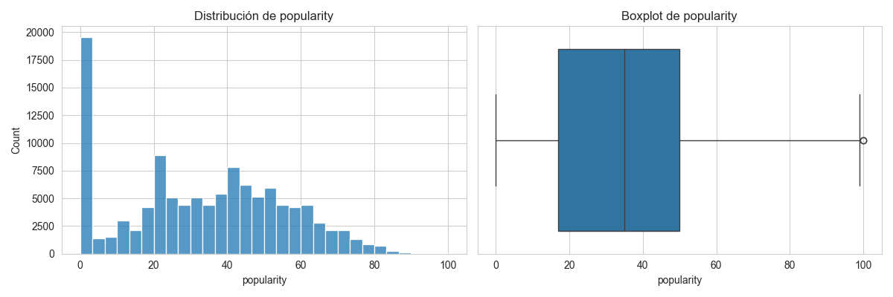
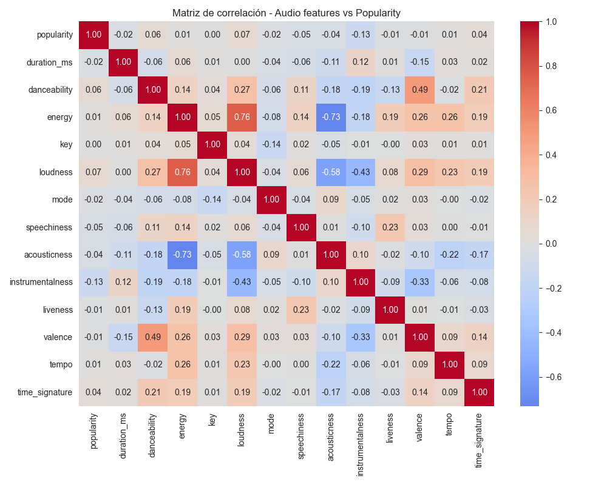
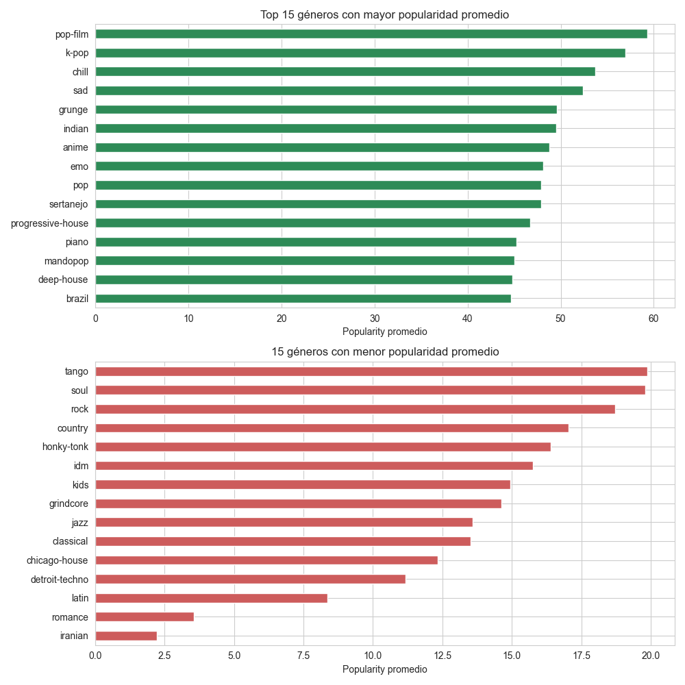
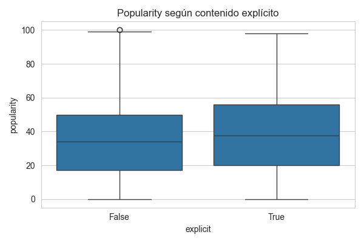
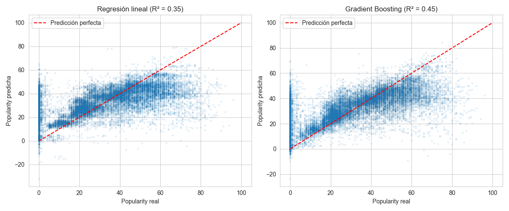
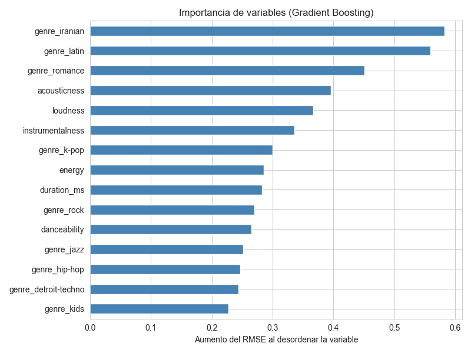
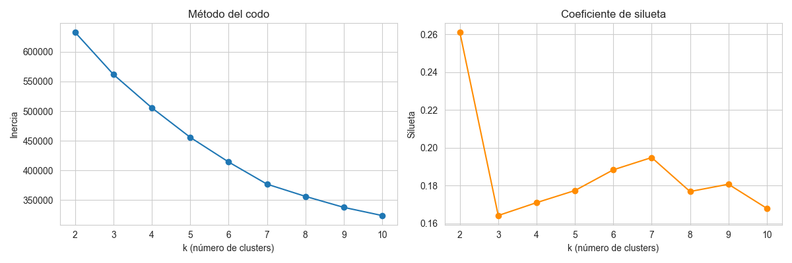
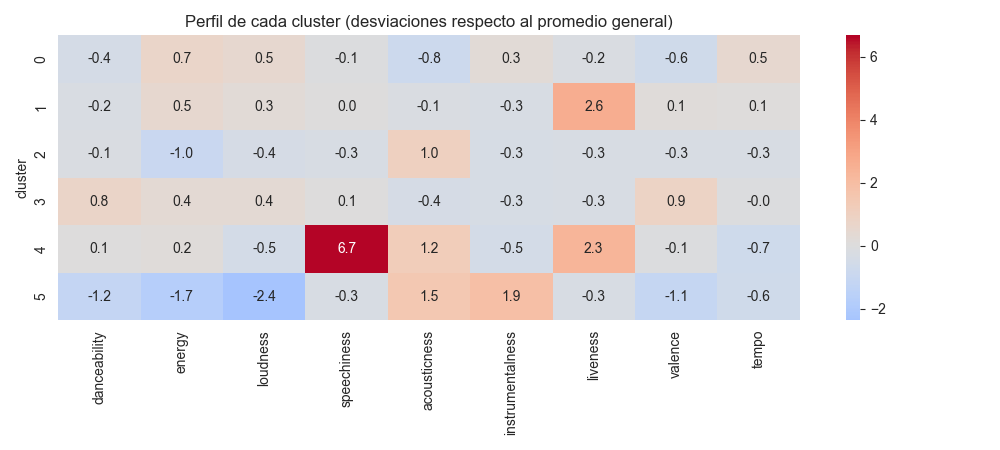
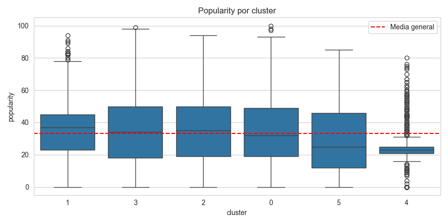
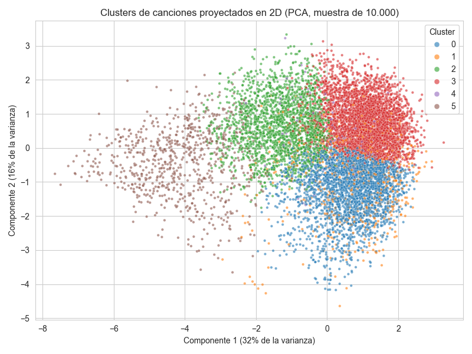

# Predicción de Popularidad de Canciones en Spotify

**Evaluación Parcial N°2 — MLY1101 Machine Learning (DuocUC)**
**Caso C: Inteligencia musical y predicción de popularidad de canciones (Spotify Tracks)**

Integrantes: Gabriel Caroca

---

## Resumen ejecutivo

Se desarrolló una solución de Machine Learning para anticipar la popularidad (`popularity`, 0-100) de una canción a partir de sus características de audio y su género, y para descubrir segmentos de canciones en el catálogo. El proyecto sigue la metodología CRISP-DM y entrega:

- **Dos modelos supervisados de regresión** (regresión lineal y Gradient Boosting) comparados contra una línea base.
- **Un modelo no supervisado** (K-Means) que segmenta el catálogo en 6 grupos de sonido interpretables.
- **Recomendaciones de negocio** para una distribuidora/plataforma musical.

| Resultado clave | Valor |
|---|---|
| Mejor modelo supervisado | Gradient Boosting (RMSE 15,11 · MAE 10,53 · R² 0,45) |
| Canciones top (popularity > 70) capturadas al priorizar el 10% con mayor predicción | ~32% (vs ~10% al azar) |
| Segmentos de canciones encontrados | 6 (K-Means) |

---

## 1. Descripción del problema de negocio

Una distribuidora/plataforma musical quiere anticipar qué tan popular será una canción a partir de sus características de audio y metadatos, para priorizar qué temas promocionar en playlists y campañas, optimizando el uso de su presupuesto de marketing. Además, necesita entender qué tipos de canciones existen en su catálogo para diferenciar sus estrategias de promoción.

## 2. Objetivos del proyecto

**Objetivo general:** desarrollar un modelo de Machine Learning que prediga el score de popularidad (`popularity`, escala 0-100) de una canción a partir de sus atributos de audio y de género, para apoyar decisiones de promoción musical.

**Objetivos específicos:**
1. Evaluar la calidad de los datos y prepararlos para el modelamiento (una fila por canción).
2. Identificar patrones y variables relevantes mediante análisis exploratorio.
3. Construir y comparar al menos dos modelos supervisados de regresión.
4. Descubrir segmentos de canciones con una técnica no supervisada.
5. Interpretar los resultados y traducirlos en recomendaciones para la distribuidora.

## 3. Definición de KPIs

| KPI | Definición | Resultado |
|---|---|---|
| **Error de predicción** | RMSE y MAE sobre `popularity` (en puntos, escala 0-100) y R² | RMSE 15,11 · MAE 10,53 · R² 0,45 (Gradient Boosting, conjunto de prueba) |
| **Canciones "top" correctamente identificadas** | Proporción de canciones con `popularity > 70` que el modelo logra detectar (recall) y su precisión | Con umbral estricto (predicho > 70): recall 1,9%, precisión 45%. Priorizando el 10% con mayor predicción: se captura ~32% de las canciones top |

## 4. Descripción de las fuentes de datos

- **Fuente:** [Spotify Tracks Dataset (Kaggle)](https://www.kaggle.com/datasets/maharshipandya/-spotify-tracks-dataset), publicado por MaharshiPandya.
- **Volumen original:** 114.000 filas y 21 columnas (una es un índice sobrante), 114 géneros musicales.
- **Variables:**
  - Metadatos: `track_id`, `artists`, `album_name`, `track_name`, `track_genre`, `explicit`.
  - Audio features calculadas por Spotify: `danceability`, `energy`, `loudness`, `valence`, `tempo`, `acousticness`, `instrumentalness`, `speechiness`, `liveness`, `key`, `mode`, `time_signature`, `duration_ms`.
- **Variable objetivo:** `popularity` (0-100).
- **Herramienta colaborativa:** repositorio en GitHub para versionar el proyecto.

## 5. Preparación y análisis exploratorio de los datos (EDA)

### 5.1 Calidad de datos y limpieza (`01_preparacion_datos.ipynb`)

| Paso | Detalle |
|---|---|
| Columna índice | Se elimina `Unnamed: 0` antes de buscar duplicados (si no, cada fila parece distinta y salen 0 duplicados). |
| Duplicados exactos | **450** filas 100% duplicadas (eliminadas). |
| Nulos y duración inválida | **1** fila con nulos (artista, álbum y nombre) que además tiene `duration_ms = 0`: es la misma fila (eliminada). |
| Total eliminado | **451** filas → 114.000 pasan a 113.549. |
| `track_id` repetidos | La misma canción aparece una vez por cada género en que está catalogada (hasta **9** veces). Dejarlas así infla el volumen y permite que la misma canción caiga en entrenamiento y en prueba (fuga de datos). |

**Corrección: una fila por canción con multi-hot encoding.** Cada género pasa a ser una columna `genre_*` con 0/1 (114 columnas); una canción en varios géneros tiene varios 1. Antes de juntar las filas se verificó que el artista, el álbum y las audio features son idénticos entre filas repetidas; solo `popularity` cambia (720 canciones, casi siempre por 1 punto), por lo que se usó el promedio. También se verificó que no se perdió información de género (113.549 pares canción-género = 113.549 unos en las nuevas columnas).

**Resultado:** 114.000 filas → 113.549 tras la limpieza → **89.740 canciones únicas** (73.441 con un solo género), con 133 columnas. Guardado en `data/processed/spotify_tracks_clean.csv`.

### 5.2 Hallazgos del EDA (`02_eda.ipynb`)

- **Distribución de `popularity`:** sesgada hacia valores bajos-medios (media ≈ 33). **10,5%** de las canciones tienen `popularity = 0` (9.413) y solo **3,0%** superan 70 (2.729).
- **Audio features:** correlación débil con `popularity`, todas por debajo de 0,13 en valor absoluto. Las más asociadas: `instrumentalness` (-0,13), `loudness` (0,07), `danceability` (0,06).
- **Género:** sí marca una diferencia grande. `pop-film` (59), `k-pop` (57) y `chill` (54) lideran; `latin` (8), `romance` (3,5) e `iranian` (2,2) quedan al final.
- **Canciones explícitas:** popularidad promedio algo mayor (36,9 vs 32,9), pero son ~8,6% del catálogo.

| | |
|---|---|
|  |  |
|  |  |

### 5.3 Evaluación de sesgos, ética y privacidad

- **Privacidad:** el dataset no contiene datos personales de usuarios, solo metadatos públicos de canciones y métricas agregadas. Riesgo bajo.
- **Sesgo de género musical:** un modelo entrenado con estos datos podría predecir sistemáticamente baja popularidad para géneros de nicho.
- **Sesgo "long tail":** unos pocos artistas/canciones concentran la mayoría de las reproducciones, lo que puede sesgar el modelo hacia valores medios-bajos.
- **Limitación:** no hay variables temporales ni de contexto (fecha de lanzamiento, artista como variable, marketing).
- **Mitigación:** usar el modelo como apoyo a la decisión de promoción, no como reemplazo del criterio experto (A&R).

## 6. Metodología utilizada (CRISP-DM)

| Fase CRISP-DM | Qué se hizo | Dónde |
|---|---|---|
| 1. Comprensión del negocio | Problema, objetivos y KPIs | Secciones 1-3, `01_preparacion_datos.ipynb` |
| 2. Comprensión de los datos | Calidad, nulos, duplicados, canciones repetidas por género, EDA | Sección 5, `01` y `02_eda.ipynb` |
| 3. Preparación de los datos | Limpieza, una fila por canción, multi-hot encoding de géneros, selección de predictores, partición 80/20 | `01_preparacion_datos.ipynb`, `03_modelado.ipynb` (5.2) |
| 4. Modelado | Regresión lineal y Gradient Boosting (supervisado); K-Means (no supervisado) | `03_modelado.ipynb`, `04_clustering.ipynb` |
| 5. Evaluación | RMSE, MAE, R², KPI de canciones top, importancia de variables, silueta y perfil de clusters; recomendaciones para el negocio | `03_modelado.ipynb` (6), `04_clustering.ipynb` (8-9) |
| 6. Despliegue | Fuera del alcance de esta evaluación. Los modelos quedan guardados en `models/` y se pueden cargar con `joblib` | `models/` |

## 7. Modelado supervisado (`03_modelado.ipynb`)

Como `popularity` es numérica (0-100), el problema es de **regresión**.

- **Predictores (128):** 13 audio features, `explicit` y las 114 columnas `genre_*`. Se excluyen `track_id`, `track_name`, `artists` y `album_name` (identificadores/texto).
- **Partición:** 80% entrenamiento (71.792 canciones) y 20% prueba (17.948), con semilla fija (`random_state=42`). Con una fila por canción, una misma canción no puede quedar en ambos conjuntos.

| Modelo | Justificación |
|---|---|
| Baseline (media) | Referencia mínima: cualquier modelo útil debe superarla. |
| Regresión lineal | Modelo base interpretable y rápido. |
| Gradient Boosting (`HistGradientBoostingRegressor`) | Captura relaciones no lineales e interacciones (género × audio features); entrena rápido con ~90.000 filas. Hiperparámetros elegidos con búsqueda aleatoria y validación cruzada de 3 particiones **solo sobre el entrenamiento**. |

**Hiperparámetros elegidos:** `learning_rate=0.1`, `max_iter=400`, `max_depth=10`, `min_samples_leaf=20`, `l2_regularization=0`.

## 8. Resultados y evaluación

### 8.1 Comparación de modelos (conjunto de prueba)

| Modelo | RMSE | MAE | R² |
|---|---|---|---|
| Baseline (media) | 20,45 | 17,12 | 0,00 |
| Regresión lineal | 16,50 | 11,81 | 0,35 |
| **Gradient Boosting** | **15,11** | **10,53** | **0,45** |

Gradient Boosting mejora a la regresión lineal en todas las métricas, lo que confirma que existen relaciones no lineales. Aun así, **R² ≈ 0,45**: más de la mitad de la variabilidad no se explica, coherente con la ausencia de variables como artista, promoción o fecha de lanzamiento. En promedio el mejor modelo se equivoca por ≈ 10,5 puntos de popularidad.



### 8.2 KPI de canciones top (popularity > 70)

En el conjunto de prueba hay 520 canciones top (2,9%).

| Estrategia | Gradient Boosting | Regresión lineal |
|---|---|---|
| Marcar como top si predicho > 70: canciones marcadas / recall / precisión | 22 / 1,9% / 45,5% | 11 / 0,4% / 18,2% |
| Marcar como top si predicho > 60: canciones marcadas / recall / precisión | 246 / 12,7% / 26,8% | 101 / 4,6% / 23,8% |
| **Priorizar el 10% con mayor predicción: % de top capturadas** | **32,3%** | 22,7% |

Los modelos de regresión tienden a predecir hacia el promedio y rara vez llegan a valores extremos, por lo que con un umbral estricto detectan pocas canciones top. Como **herramienta de priorización** el modelo sí es útil: concentra ~3 veces más canciones exitosas que elegir al azar.

### 8.3 Importancia de variables



Los géneros (`iranian`, `latin`, `romance`, `k-pop`) están entre las variables más importantes, junto con `acousticness`, `loudness` e `instrumentalness`. Importancia no implica causalidad.

## 9. Aprendizaje no supervisado: segmentación de canciones (`04_clustering.ipynb`)

**Técnica:** K-Means sobre 9 audio features estandarizadas (`danceability`, `energy`, `loudness`, `speechiness`, `acousticness`, `instrumentalness`, `liveness`, `valence`, `tempo`). El género y `popularity` **no** entran al algoritmo: se usan después para interpretar los grupos.

**Elección de k = 6:** el codo no muestra un quiebre claro; la silueta es máxima con k = 2 (0,26) pero solo separa "intensas" de "suaves", poco útil para el negocio. Con k = 6-7; se eligió 6 por interpretabilidad, la diferencia es mínima (silueta 0,19, máximo local) los grupos son interpretables y coinciden con familias de géneros. La silueta baja indica grupos con solapamiento: son tendencias, no categorías cerradas.

| Cluster | Perfil | Géneros característicos | Canciones | Popularity media | % top |
|---|---|---|---|---|---|
| 0 | Intensas y agresivas | death-metal, grindcore, black-metal | 24.302 | 33,3 | 2,6% |
| 1 | En vivo (liveness alta) | pagode, sertanejo, samba | 6.639 | 34,8 | 1,4% |
| 2 | Acústicas y suaves | tango, honky-tonk, jazz | 19.471 | 33,7 | 2,7% |
| 3 | Bailables y alegres | reggaeton, latino, reggae | 31.186 | 33,8 | **4,7%** |
| 4 | Habladas | comedy (76% del cluster) | 1.052 | 24,6 | 0,5% |
| 5 | Ambientales e instrumentales | new-age, sleep, ambient, classical | 7.090 | 28,6 | 0,4% |

K-Means, sin conocer el género, redescubrió agrupaciones de géneros coherentes. El cluster **explica solo ≈ 0,7% de la variabilidad de `popularity`**: el sonido por sí solo casi no determina la popularidad, pero el segmento bailable y alegre concentra la mayor proporción de canciones top.

| | |
|---|---|
|  |  |
|  |  |

## 10. Conclusiones y recomendaciones para la distribuidora

1. **Gradient Boosting es el mejor modelo** (RMSE 15,11, MAE 10,53, R² 0,45) y supera a la regresión lineal y a la línea base.
2. **Úsese como herramienta de priorización, no como predictor exacto:** al promocionar solo el 10% de canciones con mayor predicción se captura ~32% de las canciones top. Debe complementar el criterio de A&R.
3. **Comparar cada canción dentro de su género o segmento**, no contra todo el catálogo: el género es de los factores más influyentes.
4. **Diferenciar campañas por segmento:**
   - Segmento **bailable y alegre** (mayor % de canciones top): priorizar promoción en playlists masivas.
   - Segmentos **de nicho** (ambientales, habladas, en vivo): apuntar a playlists temáticas (sueño, estudio, humor, música regional) y fijar metas de reproducciones acordes.
5. **Limitaciones y trabajo futuro:** el rendimiento tiene un techo por la falta de variables de contexto (artista, fecha de lanzamiento, inversión en marketing); se recomienda incorporarlas. Los clusters tienen solapamiento (silueta ≈ 0,19).

## Estructura del proyecto

```
ev1_machine_learning/
├── data/
│   ├── raw/
│   │   └── dataset.csv                    # Dataset original (Kaggle)
│   └── processed/
│       ├── spotify_tracks_clean.csv       # Una fila por canción, géneros multi-hot
│       └── clusters_canciones.csv         # Cluster asignado a cada canción
├── notebooks/
│   ├── 01_preparacion_datos.ipynb         # Negocio, calidad de datos, limpieza, multi-hot
│   ├── 02_eda.ipynb                       # Análisis exploratorio y sesgos
│   ├── 03_modelado.ipynb                  # Modelos supervisados y evaluación
│   └── 04_clustering.ipynb                # K-Means y segmentación
├── models/
│   ├── regresion_lineal.joblib
│   ├── gradient_boosting.joblib
│   ├── columnas_modelo.joblib             # Orden de columnas esperado por los modelos
│   ├── metricas_modelos.csv
│   ├── kmeans.joblib
│   └── scaler_clustering.joblib
├── images/                                # Gráficos generados por los notebooks
├── requirements.txt
└── README.md
```

## Cómo reproducir el proyecto

1. Clonar el repositorio e instalar las dependencias (Python 3.10 o superior):
   ```bash
   pip install -r requirements.txt
   ```
2. Abrir Jupyter y ejecutar los notebooks **en orden** (cada uno usa rutas relativas, por lo que deben ejecutarse desde la carpeta `notebooks/`):
   1. `01_preparacion_datos.ipynb` genera `data/processed/spotify_tracks_clean.csv`.
   2. `02_eda.ipynb` genera los gráficos del EDA en `images/`.
   3. `03_modelado.ipynb` entrena y guarda los modelos en `models/` (la búsqueda de hiperparámetros tarda ~3 minutos).
   4. `04_clustering.ipynb` entrena K-Means y guarda el modelo y las asignaciones.
3. Las cifras de este informe se obtuvieron con `random_state=42`. Con otra versión de scikit-learn los resultados pueden variar levemente, y los números de cluster pueden cambiar (los perfiles se mantienen).
