# Predicción de Popularidad de Canciones en Spotify

**Evaluación Parcial N°2 — MLY1101 Machine Learning (DuocUC)**
**Caso C: Inteligencia musical y predicción de popularidad de canciones (Spotify Tracks)**

Integrantes: Gabriel Caroca

---

## Resumen ejecutivo

Se desarrolló una solución de Machine Learning para anticipar la popularidad (`popularity`, 0-100) de una canción a partir de sus características de audio y su género, y para descubrir segmentos de canciones en el catálogo. El proyecto sigue la metodología CRISP-DM y entrega:

- **Dos modelos supervisados de regresión** (regresión lineal y Gradient Boosting) comparados contra una línea base.
- **Un modelo no supervisado** (K-Means) que segmenta el catálogo en 6 grupos de sonido interpretables.
- **Recomendaciones de negocio** para una distribuidora/plataforma musical.

| Resultado clave | Valor |
|---|---|
| Mejor modelo supervisado | Gradient Boosting (RMSE 16,84 · MAE 11,85 · R² 0,345), evaluado con artistas no vistos |
| Canciones top (popularity > 70) capturadas al priorizar el 10% con mayor predicción | ~29% (vs ~10% al azar) |
| Segmentos de canciones encontrados | 6 (K-Means) |

---

## 1. Descripción del problema de negocio

Una distribuidora/plataforma musical quiere anticipar qué tan popular será una canción a partir de sus características de audio y metadatos, para priorizar qué temas promocionar en playlists y campañas, optimizando el uso de su presupuesto de marketing. Además, necesita entender qué tipos de canciones existen en su catálogo para diferenciar sus estrategias de promoción.

## 2. Objetivos del proyecto

**Objetivo general:** desarrollar un modelo de Machine Learning que prediga el score de popularidad (`popularity`, escala 0-100) de una canción a partir de sus atributos de audio y de género, para apoyar decisiones de promoción musical.

**Objetivos específicos:**
1. Evaluar la calidad de los datos y prepararlos para el modelamiento (una fila por canción).
2. Identificar patrones y variables relevantes mediante análisis exploratorio.
3. Construir y comparar al menos dos modelos supervisados de regresión.
4. Descubrir segmentos de canciones con una técnica no supervisada.
5. Interpretar los resultados y traducirlos en recomendaciones para la distribuidora.

## 3. Definición de KPIs

| KPI | Definición | Resultado |
|---|---|---|
| **Error de predicción** | RMSE y MAE sobre `popularity` (en puntos, escala 0-100) y R² | RMSE 16,84 · MAE 11,85 · R² 0,345 (Gradient Boosting, conjunto de prueba con artistas no vistos) |
| **Canciones "top" correctamente identificadas** | Proporción de canciones con `popularity > 70` que el modelo logra detectar (recall) y su precisión | Con umbral estricto (predicho > 70): recall 1,1%, precisión 23%. Priorizando el 10% con mayor predicción: se captura ~29% de las canciones top |

## 4. Descripción de las fuentes de datos

- **Fuente:** [Spotify Tracks Dataset (Kaggle)](https://www.kaggle.com/datasets/maharshipandya/-spotify-tracks-dataset), publicado por MaharshiPandya.
- **Volumen original:** 114.000 filas y 21 columnas (una es un índice sobrante), 114 géneros musicales.
- **Variables:**
  - Metadatos: `track_id`, `artists`, `album_name`, `track_name`, `track_genre`, `explicit`.
  - Audio features calculadas por Spotify: `danceability`, `energy`, `loudness`, `valence`, `tempo`, `acousticness`, `instrumentalness`, `speechiness`, `liveness`, `key`, `mode`, `time_signature`, `duration_ms`.
- **Variable objetivo:** `popularity` (0-100).
- **Herramienta colaborativa:** repositorio en GitHub para versionar el proyecto.

## 5. Preparación y análisis exploratorio de los datos (EDA)

### 5.1 Calidad de datos y limpieza (`01_preparacion_datos.ipynb`)

| Paso | Detalle |
|---|---|
| Columna índice | Se elimina `Unnamed: 0` antes de buscar duplicados (si no, cada fila parece distinta y salen 0 duplicados). |
| Duplicados exactos | **450** filas 100% duplicadas (eliminadas). |
| Nulos y duración inválida | **1** fila con nulos (artista, álbum y nombre) que además tiene `duration_ms = 0`: es la misma fila (eliminada). |
| Total eliminado | **451** filas → 114.000 pasan a 113.549. |
| Valores inválidos o extremos | `tempo = 0` (157 canciones, todas con `time_signature = 0`; en total hay 162 con `time_signature = 0`), `loudness > 0` dB (68), duración < 30 s (14) y > 20 min (73): **313 canciones (0,35%)**. Parecen fallos del análisis automático de audio; se **conservan y se documentan** (efecto marginal; ver `01_preparacion_datos.ipynb`, sección 2.4.1). |
| `track_id` repetidos | La misma canción aparece una vez por cada género en que está catalogada (hasta **9** veces). Dejarlas así infla el volumen y permite que la misma canción caiga en entrenamiento y en prueba (fuga de datos). |

**Corrección: una fila por canción con multi-hot encoding.** Cada género pasa a ser una columna `genre_*` con 0/1 (114 columnas); una canción en varios géneros tiene varios 1. Antes de juntar las filas se verificó que el artista, el álbum y las audio features son idénticos entre filas repetidas; solo `popularity` cambia (720 canciones, casi siempre por 1 punto), por lo que se usó el promedio. También se verificó que no se perdió información de género (113.549 pares canción-género = 113.549 unos en las nuevas columnas).

**Resultado:** 114.000 filas → 113.549 tras la limpieza → **89.740 canciones únicas** (73.441 con un solo género), con 133 columnas. Guardado en `data/processed/spotify_tracks_clean.csv`.

### 5.2 Hallazgos del EDA (`02_eda.ipynb`)

- **Distribución de `popularity`:** sesgada hacia valores bajos-medios (media ≈ 33). **10,5%** de las canciones tienen `popularity = 0` (9.413) y solo **3,0%** superan 70 (2.729).
- **Audio features:** correlación débil con `popularity`, todas por debajo de 0,13 en valor absoluto. Las más asociadas: `instrumentalness` (-0,13), `loudness` (0,07), `danceability` (0,06).
- **Género:** sí marca una diferencia grande. `pop-film` (59), `k-pop` (57) y `chill` (54) lideran; `latin` (8), `romance` (3,5) e `iranian` (2,2) quedan al final.
- **`popularity = 0` por género (sección 3.5 del EDA):** 12 de los 114 géneros tienen al menos 40% de canciones con 0 (`jazz` 68%, `iranian` 66%, `romance` 61%, `soul` 61%, `latin` 59%, `country` 59%), contra 0,2% en `pop-film` y una mediana de 6,9%. Sin esos ceros, el promedio de `latin` pasa de 8,4 a 20,3, el de `iranian` de 2,2 a 6,5 y el de `romance` de 3,5 a 9,2. No se puede saber si son canciones sin reproducciones o datos no registrados.
- **Canciones explícitas:** popularidad promedio algo mayor (36,9 vs 32,9), pero son ~8,6% del catálogo.

| | |
|---|---|
|  |  |
|  |  |
| 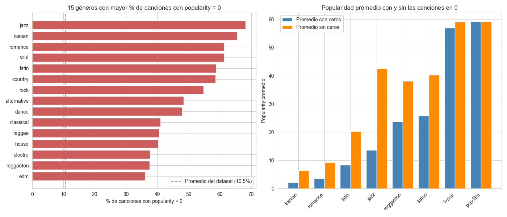 | |

### 5.3 Evaluación de sesgos, ética y privacidad

- **Privacidad:** el dataset no contiene datos personales de usuarios, solo metadatos públicos de canciones y métricas agregadas. Riesgo bajo.
- **Sesgo de género musical:** un modelo entrenado con estos datos podría predecir sistemáticamente baja popularidad para géneros de nicho.
- **Dataset balanceado por construcción:** cada género aporta entre 904 y 1.000 canciones. Es un diseño de la muestra, no el reflejo del mercado; las proporciones de géneros, el % de canciones top o el % de ceros **no deben leerse como estadísticas de la industria**.
- **Géneros con nombres engañosos:** `latin` es un género distinto de `reggaeton` o `latino` (38% y 36% de ceros). Que `latin` tenga baja popularidad promedio **no implica que la música latina sea poco popular**.
- **Ceros concentrados en ciertos géneros:** si son un artefacto de la recolección, el modelo podría penalizar a esos géneros por una razón ajena a la música (se mide en la sección 8.3).
- **Sesgo "long tail":** unos pocos artistas/canciones concentran la mayoría de las reproducciones, lo que puede sesgar el modelo hacia valores medios-bajos.
- **Limitación:** no hay variables temporales ni de contexto (fecha de lanzamiento, artista como variable, marketing).
- **Mitigación:** usar el modelo como apoyo a la decisión de promoción, no como reemplazo del criterio experto (A&R).

## 6. Metodología utilizada (CRISP-DM)

| Fase CRISP-DM | Qué se hizo | Dónde |
|---|---|---|
| 1. Comprensión del negocio | Problema, objetivos y KPIs | Secciones 1-3, `01_preparacion_datos.ipynb` |
| 2. Comprensión de los datos | Calidad, nulos, duplicados, canciones repetidas por género, EDA | Sección 5, `01` y `02_eda.ipynb` |
| 3. Preparación de los datos | Limpieza, una fila por canción, multi-hot encoding de géneros, selección de predictores, partición 80/20 por artista | `01_preparacion_datos.ipynb`, `03_modelado.ipynb` (5.2) |
| 4. Modelado | Regresión lineal y Gradient Boosting (supervisado); K-Means (no supervisado) | `03_modelado.ipynb`, `04_clustering.ipynb` |
| 5. Evaluación | RMSE, MAE, R², KPI de canciones top, importancia de variables, silueta y perfil de clusters; recomendaciones para el negocio | `03_modelado.ipynb` (6), `04_clustering.ipynb` (8-9) |
| 6. Despliegue | Fuera del alcance de esta evaluación. Los modelos quedan guardados en `models/` y se pueden cargar con `joblib` | `models/` |

## 7. Modelado supervisado (`03_modelado.ipynb`)

Como `popularity` es numérica (0-100), el problema es de **regresión**.

- **Predictores (128):** 13 audio features, `explicit` y las 114 columnas `genre_*`. Se excluyen `track_id`, `track_name`, `artists` y `album_name` (identificadores/texto). `key` y `mode` se usan como numéricas: para los árboles no es problema y, en la regresión lineal, el efecto de `key` es prácticamente nulo.
- **Partición por artista:** 80% entrenamiento (72.065 canciones, 25.149 artistas) y 20% prueba (17.675 canciones, 6.288 artistas), con `GroupShuffleSplit` agrupando por `artists` y semilla fija (`random_state=42`). Todas las canciones de un mismo artista quedan juntas, así que el modelo se evalúa con artistas que nunca vio, que es la situación real de una distribuidora que evalúa un lanzamiento nuevo. Las colaboraciones (`"A;B"`) se tratan como un grupo propio.
- **Predicciones recortadas a 0-100:** `popularity` solo existe en ese rango; antes de evaluar se recortan las predicciones fuera de él (63 de la regresión lineal y 12 de Gradient Boosting eran negativas).

| Modelo | Justificación |
|---|---|
| Baseline (media) | Referencia mínima: cualquier modelo útil debe superarla. |
| Regresión lineal | Modelo base interpretable y rápido. |
| Gradient Boosting (`HistGradientBoostingRegressor`) | Captura relaciones no lineales e interacciones (género × audio features); entrena rápido con ~90.000 filas. Hiperparámetros elegidos con búsqueda aleatoria (15 combinaciones) y validación cruzada de 3 particiones agrupadas por artista (`GroupKFold`) **solo sobre el entrenamiento**, con `early_stopping=False` para que el número de árboles lo decida la búsqueda. |

**Hiperparámetros elegidos:** `learning_rate=0.03`, `max_iter=400`, `max_leaf_nodes=63`, `max_depth=None`, `min_samples_leaf=200`, `l2_regularization=10` (RMSE de validación cruzada por artista: 16,30). **Ampliar la búsqueda no mejoró el modelo:** una búsqueda previa más pequeña (8 combinaciones) había dado 16,29 en validación cruzada y 16,84 en prueba, igual que ahora. El rendimiento se estabiliza en una meseta; el límite parece estar en la información disponible y no en los hiperparámetros. Dos valores (`learning_rate` y `max_leaf_nodes`) quedaron en el borde de la grilla, pero la diferencia entre búsquedas fue de solo 0,015 de RMSE.

### 7.1 Por qué una partición por artista (control de fuga de datos)

Una misma canción puede aparecer con varios `track_id` (álbum, sencillo, recopilatorio) y un mismo artista tiene muchas canciones parecidas. Con una partición aleatoria por canción, **75% de las canciones de prueba tienen a su artista en el entrenamiento** y **13% tienen otra versión de la misma canción** (mismo artista y nombre). Esas canciones casi idénticas quedan repartidas entre entrenamiento y prueba y el modelo las "reconoce", lo que infla las métricas. Para cuantificarlo, se entrenaron los mismos modelos con los mismos hiperparámetros con ambas particiones:

| Modelo | Partición | RMSE | MAE | R² prueba | R² entrenamiento |
|---|---|---|---|---|---|
| Regresión lineal | Aleatoria por canción | 16,49 | 11,79 | 0,350 | 0,360 |
| Regresión lineal | **Por artista (usada)** | 17,22 | 12,32 | 0,315 | 0,366 |
| Gradient Boosting | Aleatoria por canción | 15,48 | 10,89 | 0,427 | 0,493 |
| Gradient Boosting | **Por artista (usada)** | 16,84 | 11,85 | 0,345 | 0,497 |

La partición aleatoria infla más a Gradient Boosting (R² 0,427 vs 0,345) que a la regresión lineal (0,350 vs 0,315). Las cifras oficiales de este informe son las de la **partición por artista**. Gradient Boosting muestra además sobreajuste: R² 0,497 en entrenamiento vs 0,345 en prueba (la regresión lineal, 0,366 vs 0,315).

## 8. Resultados y evaluación

### 8.1 Comparación de modelos (conjunto de prueba)

| Modelo | RMSE | MAE | R² |
|---|---|---|---|
| Baseline (media) | 20,81 | 17,48 | 0,000 |
| Regresión lineal | 17,22 | 12,32 | 0,315 |
| **Gradient Boosting** | **16,84** | **11,85** | **0,345** |

Ambos modelos superan la línea base (RMSE -17% la regresión lineal y -19% Gradient Boosting). Gradient Boosting mejora a la regresión lineal en las tres métricas, **pero la mejora es modesta** (RMSE -0,37 puntos, MAE -0,47 puntos, R² de 0,315 a 0,345); con la partición aleatoria la diferencia parecía mayor (sección 7.1). **R² ≈ 0,35**: ≈ 65% de la variabilidad no se explica, coherente con la ausencia de variables como artista, promoción o fecha de lanzamiento. En promedio el mejor modelo se equivoca por ≈ 11,8 puntos de popularidad.


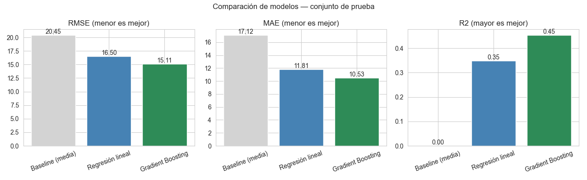

**Análisis de errores (Gradient Boosting).** Los residuos (real - predicho) están centrados cerca de 0 y son apenas más estrechos que los de la regresión lineal (desv. estándar 16,8 vs 17,2), pero el error **no es parejo**: crece en los extremos de popularidad porque el modelo se comprime hacia el promedio.

| Popularity real | Canciones (prueba) | MAE regresión lineal | MAE Gradient Boosting | Sesgo GB (real - predicho) |
|---|---|---|---|---|
| 0 | 1.795 | 25,6 | 25,8 | -25,8 (sobreestima) |
| 1-20 | 3.288 | 10,0 | 9,9 | -9,1 |
| 21-40 | 5.991 | 6,6 | 6,4 | -3,4 |
| 41-60 | 4.771 | 10,2 | 9,6 | +8,2 |
| 61-70 | 1.280 | 22,7 | 20,6 | +20,4 |
| 71-100 (top) | 550 | 39,3 | 36,8 | +36,8 (subestima) |

| | |
|---|---|
| 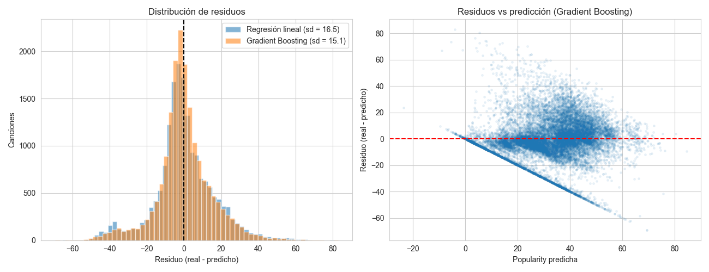 | 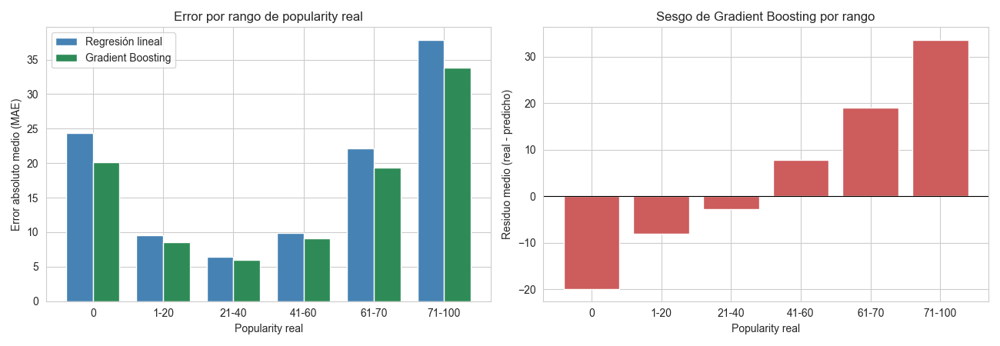 |

El modelo es confiable para canciones de popularidad media (MAE ≈ 6) pero se equivoca ≈ 37 puntos en las canciones top y ≈ 26 en las de `popularity = 0`. En el gráfico de residuos vs predicción, la diagonal corresponde a las canciones con `popularity = 0`.

### 8.2 KPI de canciones top (popularity > 70)

En el conjunto de prueba hay 550 canciones top (3,1%).

| Estrategia | Gradient Boosting | Regresión lineal |
|---|---|---|
| Marcar como top si predicho > 70: canciones marcadas / recall / precisión | 26 / 1,1% / 23,1% | 7 / 0,2% / 14,3% |
| Marcar como top si predicho > 60: canciones marcadas / recall / precisión | 204 / 8,5% / 23,0% | 77 / 3,8% / 27,3% |
| **Priorizar el 10% con mayor predicción: % de top capturadas** | **28,9%** | 23,5% |

Los modelos de regresión tienden a predecir hacia el promedio y rara vez llegan a valores extremos, por lo que con un umbral estricto detectan pocas canciones top. Como **herramienta de priorización** el modelo sí es útil: concentra ~2,9 veces más canciones exitosas que elegir al azar.

**Evaluación gráfica del KPI.** Para evaluar el KPI con matrices de confusión, se convierte a clasificación binaria: top real (`popularity > 70`) vs top predicha (predicción > umbral). Los modelos no se vuelven a entrenar.

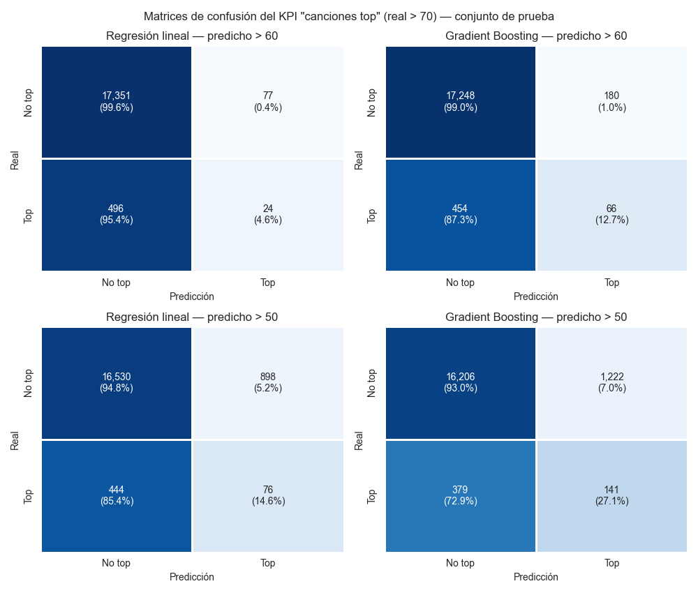

- Con umbral 60, Gradient Boosting detecta **47 de 550 canciones top (recall 8,5%)** con 157 falsas alarmas (precisión 23,0%); la regresión lineal detecta 21 (3,8%).
- Con umbral 50 el recall sube (GB 27,3%, lineal 19,8%), pero GB marca 1.532 canciones y solo 150 son top (precisión 9,8%): bajar el umbral encuentra más éxitos a costa de más falsas alarmas.

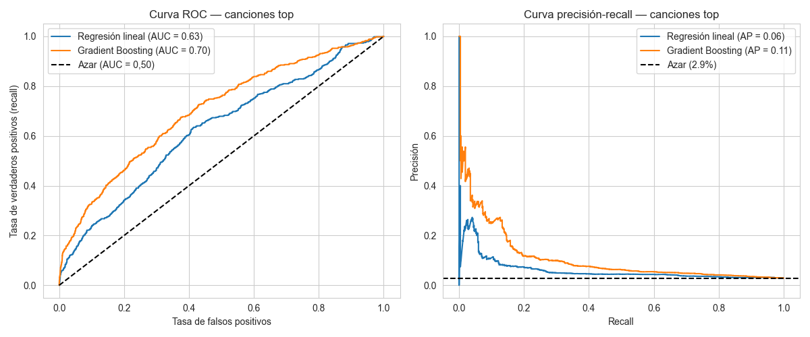

Usando la predicción como puntaje, **AUC = 0,63 (Gradient Boosting) vs 0,59 (regresión lineal)**, con azar = 0,50, y precisión promedio (AP) = 0,09 vs 0,06 frente a una base de 3,1%. El modelo ordena algo mejor que el azar, pero su capacidad de separar top de no top es **limitada**.

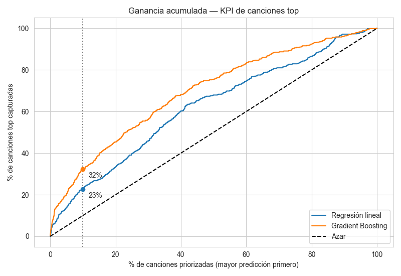

La curva de ganancia acumulada muestra que, al priorizar el 10% con mayor predicción, Gradient Boosting captura el 29% de las canciones top (lineal 23%, azar 10%); con el 5% y el 20% captura 20% y 36%.

### 8.3 Importancia de variables y efecto de `popularity = 0`


**14 de las 15 variables más importantes son géneros** (`iranian`, `latin`, `romance`, `kids`, `country`, `detroit-techno`, entre otros); la única audio feature entre ellas es `loudness` (puesto 12). Saber el género dice mucho sobre qué tan popular será una canción, incluso para artistas que el modelo no ha visto. Los coeficientes de la regresión lineal van en el mismo sentido: pertenecer a `romance`, `iranian` o `latin` resta ≈ 30-37 puntos y a `pop-film` o `k-pop` suma ≈ 15, mientras que ninguna audio feature mueve la popularidad más de ≈ 0,9 puntos por desviación estándar.

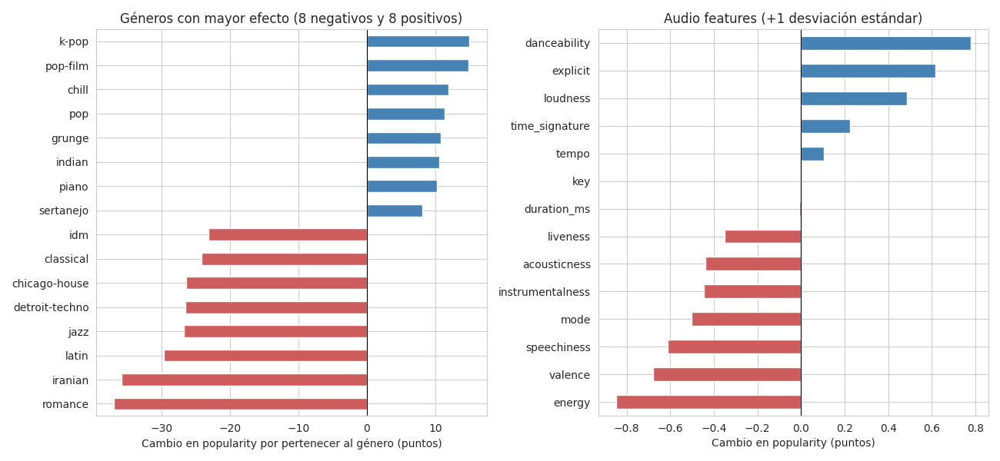

**Sensibilidad a `popularity = 0`.** Como `iranian`, `latin` y `romance` encabezan la importancia y tienen muchos ceros, se reentrenó Gradient Boosting sin las canciones con `popularity = 0` (el modelo oficial **sí** las conserva) para ver cuánto del resultado dependía de ellas:

| Género | Importancia con ceros (puesto) | Importancia sin ceros (puesto) |
|---|---|---|
| `iranian` | 0,71 (1) | 0,13 (19) |
| `latin` | 0,57 (2) | 0,18 (12) |
| `romance` | 0,38 (3) | 0,29 (4) |
| `k-pop` | 0,16 (14) | 0,20 (9) |

| Evaluación | RMSE | MAE | R² |
|---|---|---|---|
| Modelo oficial, prueba completa | 16,84 | 11,85 | 0,345 |
| Modelo oficial, prueba solo con `popularity > 0` | 14,70 | 10,28 | 0,375 |
| Modelo sin ceros, prueba solo con `popularity > 0` (otra población, no comparable) | 13,66 | 9,57 | 0,461 |

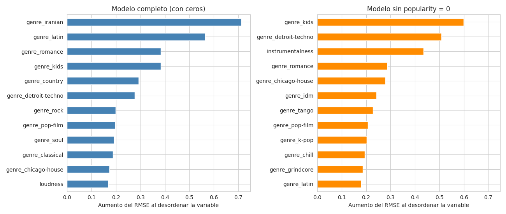

El desempeño **no** es un artefacto de los ceros, pero el peso de `iranian` y `latin` sí venía en gran parte de ellos (cae ≈ 82% y ≈ 68%). Los primeros puestos sin ceros son `kids` y `detroit-techno`, e `instrumentalness` sube al tercer lugar. Por eso **"el género es el predictor más informativo" se sostiene, pero "el género determina la popularidad" es exagerado**. Importancia no implica causalidad.

## 9. Aprendizaje no supervisado: segmentación de canciones (`04_clustering.ipynb`)

**Técnica:** K-Means sobre 9 audio features estandarizadas (`danceability`, `energy`, `loudness`, `speechiness`, `acousticness`, `instrumentalness`, `liveness`, `valence`, `tempo`). El género y `popularity` **no** entran al algoritmo: se usan después para interpretar los grupos.

**Elección de k = 6:** el codo no muestra un quiebre claro. La silueta es máxima con k = 2 (0,26), pero solo separa "intensas" de "suaves", lo que es poco útil para el negocio. Desde k = 3 la silueta es baja (≈ 0,16-0,20): k = 5: 0,177, **k = 6: 0,188, k = 7: 0,195**, k = 8: 0,177. El valor más alto está en k = 7, pero la diferencia con k = 6 es mínima (0,007); **se prefirió k = 6 por interpretabilidad y simplicidad** (ver la comparación k = 6 vs. k = 7 más abajo). Una silueta de ≈ 0,19 indica grupos con solapamiento: son tendencias, no categorías cerradas.

| Cluster | Perfil | Géneros característicos | Canciones | Popularity media | % top |
|---|---|---|---|---|---|
| 0 | Intensas y agresivas | death-metal, grindcore, black-metal | 24.302 | 33,3 | 2,6% |
| 1 | En vivo (liveness alta) | pagode, sertanejo, samba | 6.639 | 34,8 | 1,4% |
| 2 | Acústicas y suaves | tango, honky-tonk, jazz | 19.471 | 33,7 | 2,7% |
| 3 | Bailables y alegres | reggaeton, latino, reggae | 31.186 | 33,8 | **4,7%** |
| 4 | Habladas | comedy (76% del cluster) | 1.052 | 24,6 | 0,5% |
| 5 | Ambientales e instrumentales | new-age, sleep, ambient, classical | 7.090 | 28,6 | 0,4% |

K-Means, sin conocer el género, redescubrió agrupaciones de géneros coherentes. El cluster **explica solo ≈ 0,7% de la variabilidad de `popularity`**: el sonido por sí solo casi no determina la popularidad, pero el segmento bailable y alegre concentra la mayor proporción de canciones top.

| | |
|---|---|
|  |  |
|  |  |
| 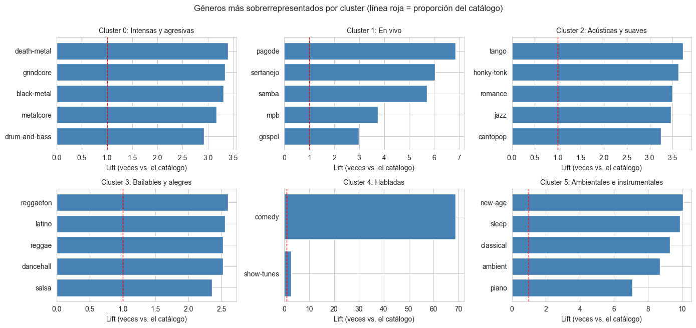 | 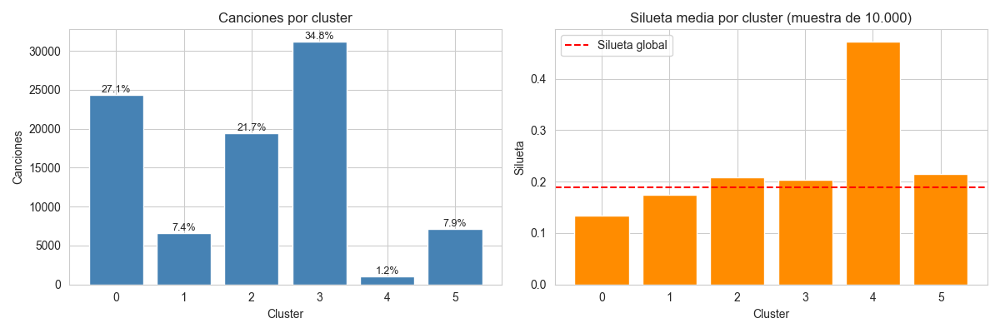 |

### 9.1 Robustez y limitaciones del clustering

Se evaluó qué tan sólida es la segmentación (sección 8.8 del notebook `04_clustering.ipynb`). Ninguna de estas pruebas modifica el modelo final (k = 6, variables estandarizadas).

| Aspecto | Resultado | Implicancia |
|---|---|---|
| Calidad por cluster | Silueta por cluster: 0,47 en el cluster 4 (habladas), pero 0,13 (cluster 0) y 0,17 (cluster 1), bajo el promedio global de 0,19; 4,8% de canciones con silueta negativa | Asignar una canción a los clusters 0 y 1 es menos confiable que a los clusters 4 y 5 |
| Variables asimétricas | `speechiness` (asimetría 4,55), `liveness` (2,06), `instrumentalness` (1,56) y `loudness` (−1,96) se estandarizaron sin transformar; los clusters 4 (`speechiness` +6,7 desv.) y 1 (`liveness` +2,6 desv.) están definidos por valores extremos | Los segmentos "extremos" son sensibles a esta decisión |
| Transformaciones probadas | Silueta (k = 6): estandarizada 0,188; log1p 0,181; Yeo-Johnson 0,162. Concordancia con la partición original (ARI): 0,62 y 0,39 | Ninguna transformación mejora la silueta, pero la partición cambia; se mantuvo la estandarización simple |
| Estabilidad | 8 de 10 semillas y 8 de 10 submuestras del 80% reproducen la solución (ARI > 0,99); el resto cae en un óptimo local algo peor (ARI 0,67, inercia 0,15% mayor) | La segmentación es un resumen razonable, no una verdad única; los tamaños por segmento pueden variar con otra semilla |
| Silueta sobre muestra | Calculada con 10.000 canciones; varía ≈ 0,002 entre 5 muestras distintas | El valor bajo refleja solapamiento real, no efecto del muestreo |
| k = 6 vs. k = 7 | Silueta 0,191 vs. 0,197 (promedio de 5 muestras). k = 7 separa un segmento de **techno** (10.109 canciones; popularity media 27,3; 0,5% top) del de metal (35,6; 3,5% top); eta² de popularity 0,7% vs. 1,9% | k = 7 es una alternativa defendible, preferible si el negocio necesita distinguir música electrónica |
| Poder explicativo | El cluster explica 0,7% de la variabilidad de `popularity` (1,4-1,9% con las variantes probadas) | El clustering sirve para segmentar el catálogo y diferenciar campañas, no para predecir popularidad |
| Dataset balanceado | Cada género tiene entre 904 y 1.000 canciones | El tamaño de los clusters refleja la composición del dataset y no la del mercado real |

## 10. Conclusiones y recomendaciones para la distribuidora

1. **Gradient Boosting es el mejor modelo** (RMSE 16,84, MAE 11,85, R² 0,345), con una ventaja modesta sobre la regresión lineal (RMSE 17,22, R² 0,315); ambos superan a la línea base y ampliar la búsqueda de hiperparámetros no mejoró el resultado. Las métricas se midieron con una partición por artista, es decir, con artistas que el modelo no conoce.
2. **Úsese como herramienta de priorización, no como predictor exacto:** al promocionar solo el 10% de canciones con mayor predicción se captura ~29% de las canciones top. Debe complementar el criterio de A&R.
3. **Comparar cada canción dentro de su género o segmento**, no contra todo el catálogo: el género es una de las señales más informativas, aunque no determina la popularidad (parte de su peso viene de géneros con muchos `popularity = 0`, sección 8.3).
4. **Diferenciar campañas por segmento:**
   - Segmento **bailable y alegre** (mayor % de canciones top): priorizar promoción en playlists masivas.
   - Segmentos **de nicho** (ambientales, habladas, en vivo): apuntar a playlists temáticas (sueño, estudio, humor, música regional) y fijar metas de reproducciones acordes.
5. **Limitaciones y trabajo futuro:** el rendimiento tiene un techo por la falta de variables de contexto (artista, fecha de lanzamiento, inversión en marketing); se recomienda incorporarlas. Los clusters se solapan (silueta ≈ 0,19), dependen de variables asimétricas sin transformar y no son del todo estables ante la semilla (sección 9.1).

## Estructura del proyecto

```
ev1_machine_learning/
├── data/
│   ├── raw/
│   │   └── dataset.csv                    # Dataset original (Kaggle)
│   └── processed/
│       ├── spotify_tracks_clean.csv       # Una fila por canción, géneros multi-hot
│       └── clusters_canciones.csv         # Cluster asignado a cada canción
├── notebooks/
│   ├── 01_preparacion_datos.ipynb         # Negocio, calidad de datos, limpieza, multi-hot
│   ├── 02_eda.ipynb                       # Análisis exploratorio y sesgos
│   ├── 03_modelado.ipynb                  # Modelos supervisados y evaluación
│   └── 04_clustering.ipynb                # K-Means y segmentación
├── models/
│   ├── regresion_lineal.joblib
│   ├── gradient_boosting.joblib
│   ├── columnas_modelo.joblib             # Orden de columnas esperado por los modelos
│   ├── metricas_modelos.csv
│   ├── kmeans.joblib
│   └── scaler_clustering.joblib
├── images/                                # Gráficos generados por los notebooks
├── requirements.txt
└── README.md
```

## Cómo reproducir el proyecto

1. Clonar el repositorio e instalar las dependencias (se verificó con Python 3.12):
   ```bash
   pip install -r requirements.txt
   ```
2. Abrir Jupyter y ejecutar los notebooks **en orden** (cada uno usa rutas relativas, por lo que deben ejecutarse desde la carpeta `notebooks/`):
   1. `01_preparacion_datos.ipynb` genera `data/processed/spotify_tracks_clean.csv`.
   2. `02_eda.ipynb` genera los gráficos del EDA en `images/`.
   3. `03_modelado.ipynb` entrena y guarda los modelos en `models/` y genera los gráficos de evaluación en `images/` (la búsqueda de hiperparámetros tarda unos 10-15 minutos en un solo núcleo).
   4. `04_clustering.ipynb` entrena K-Means y guarda el modelo y las asignaciones.
3. Las cifras de este informe se obtuvieron con `random_state=42`. Se verificaron con pandas 3.0.2, numpy 2.4.4 y scikit-learn 1.8.0 (versiones fijadas en `requirements.txt`; el notebook 03 imprime las versiones que usa). Con otra versión de scikit-learn los resultados pueden variar levemente, y los números de cluster pueden cambiar (los perfiles se mantienen).
